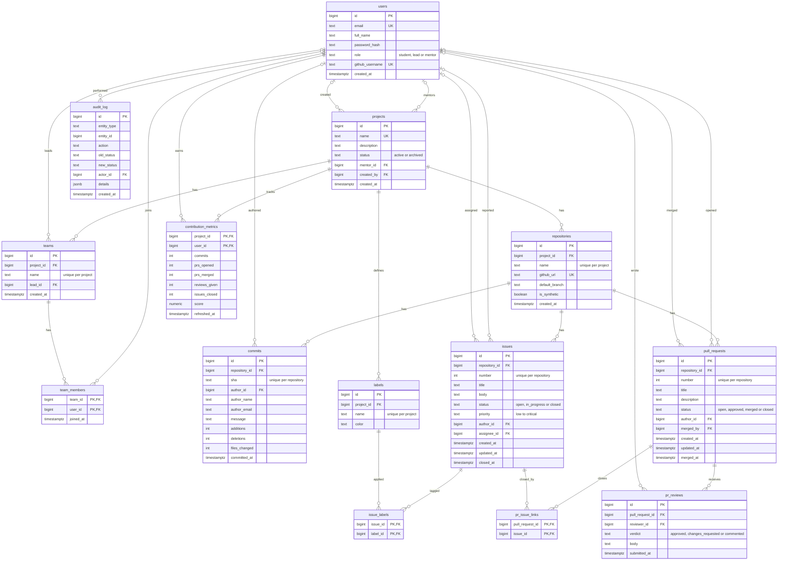

# ER diagram: all 14 tables (P1-02, P1-05)

Mermaid source matching `db/schema/01_core.sql`. Render it with `docs/render_er.sh`, or paste the block into draw.io via Arrange → Insert → Advanced → Mermaid. `audit_log.entity_id` is deliberately not a foreign key: one column refers to several tables, so history survives deletion of the row it describes.

Notation: `||` = exactly one (mandatory FK), `|o` = zero or one (nullable FK), `o{` = zero or many.

