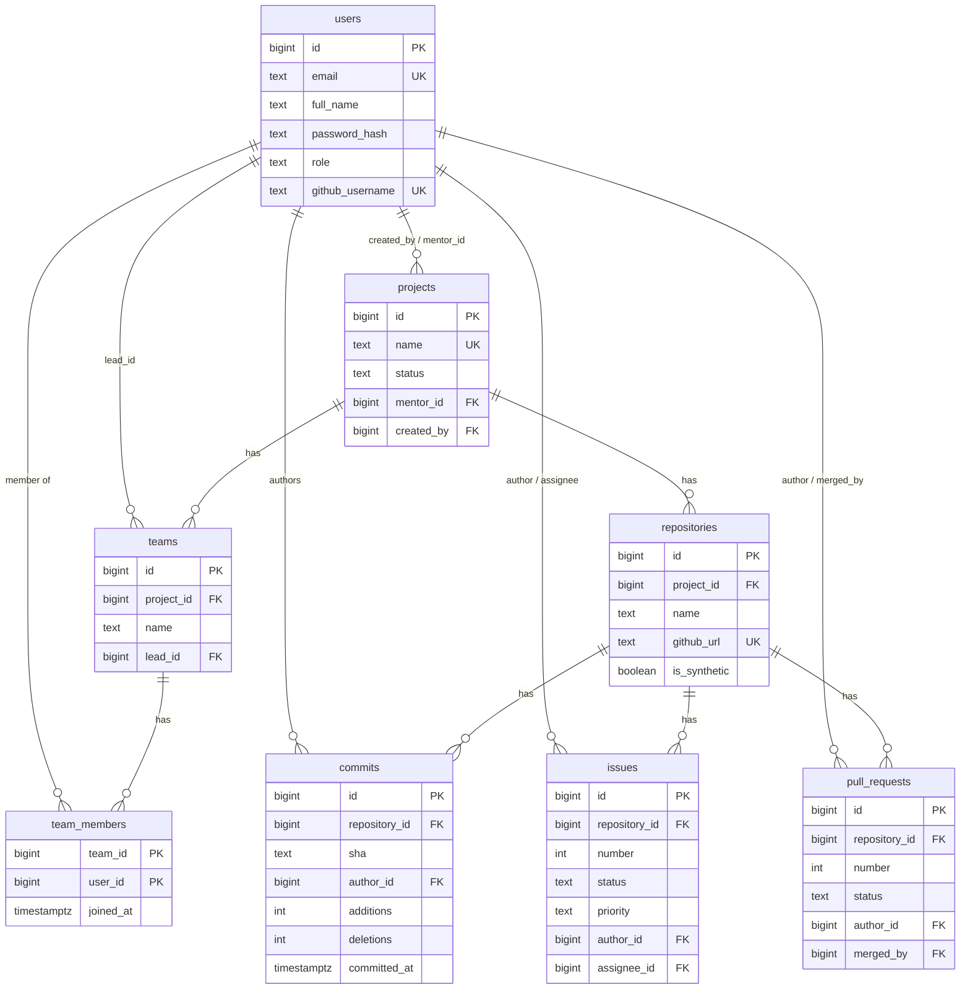

# ER diagram: core 8 tables (draft for P1-02)

Mermaid draft matching `db/schema/01_core.sql`. Redraw it in draw.io for the deliverable (export to `docs/er.drawio` and `docs/er.png`), and extend it with the remaining six tables in Week 2.

